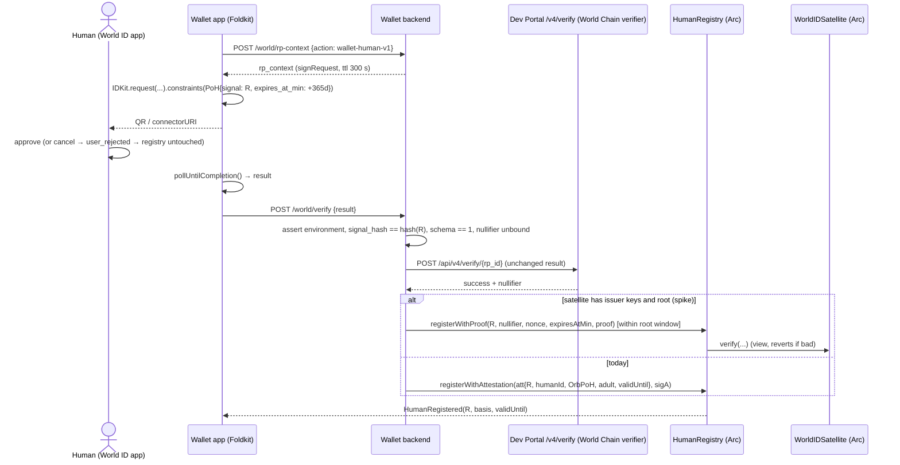
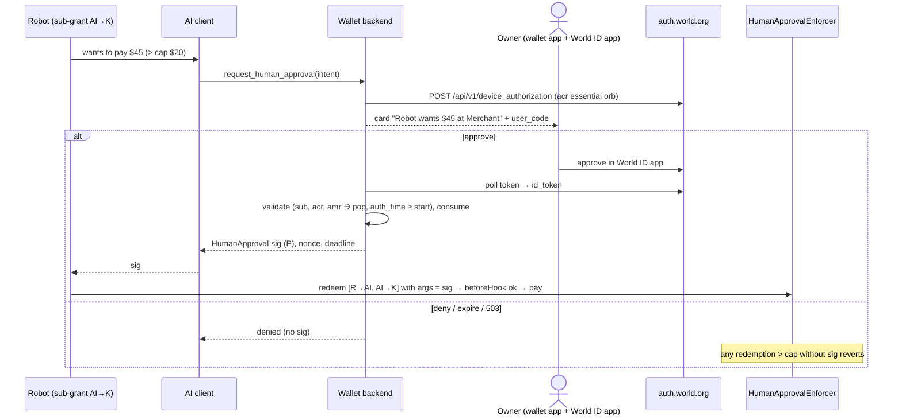

# World v2: getting a verified human's World credential to their agents and merchants

Researched 2026-11-05, event day 1. This note builds on [`world.md`](world.md), which covers the Agent
Pass device flow, `human-in-the-loop` and the prize text. Read that one first; this one doesn't repeat it.

Confidence tags used in the tables:

- **[V]**: verified live (RPC call, curl, MCP call) or read in source code.
- **[D]**: stated in official docs.
- **[S]**: secondary source, such as a press article or a blog post.
- **[I]**: inferred by us.

## TL;DR

1. **Recommendation, a combination of C and A:**
   - **18+ rule (C):**
     - The human verifies once in the wallet with IDKit.
     - The result is written to a `HumanRegistry` on Arc, keyed by the **root passkey account**.
     - The merchant's `Checkout` contract checks `isAdult(msg.sender)` when the agent pays. With
       delegations, `msg.sender` is always the root account.
     - Over MCP the agent receives only the account, the registry address and a status snapshot. It
       gets no proofs and no World secrets, and the human is not needed per purchase.
   - **Over-limit spends (A):**
     - The human approves with the Agent Pass device flow.
     - The backend then co-signs an EIP-712 `HumanApproval`.
     - A `HumanApprovalEnforcer` caveat on the root grant requires that signature above the cap, so
       the cap also applies to the robot's sub-grant.
2. **On-chain verification on Arc is broken today.**
   - We read the Arc `WorldIDSatellite` (`0x304E…E394`) live. It holds **no issuer public keys** for
     Proof of Human (1), Passport (9303), MNC (9310) or Selfie Check (11).
   - A dummy `verify()` with a valid root reverts with **`UnregisteredIssuerSchemaId()`**
     (`0xc7eb504d`).
   - The cause: World Chain's `WorldIDSource` never propagated those keys. The registry has them, the
     source holds zeros.
   - The fix is **permissionless**: call `propagateState([1,9303,9310,11], [])` on World Chain. Our
     `eth_call` simulation of it succeeds; it estimates 441,925 gas.
   - **Ask World at the booth before doing it ourselves.**
   - A second problem: Arc gets **one World Chain root per hour** (measured over 28 h), while World
     Chain mints about 5 per hour. Most fresh proofs would therefore fail with `InvalidMerkleRoot` on
     Arc even after the fix.
   - Until then the registry is written by **our attester** after `POST /api/v4/verify`, which uses
     World's World Chain verifier.
3. **No World ID 4.0 proof can carry age.**
   - The circuit's 15 public inputs have no attribute predicate, and the protocol's credential claims
     are "not in use in proofs yet".
   - `identityCheck({minimum_age: 18})` returns `identity_attested`, a **plain boolean outside the
     proof**. `/api/v4/verify` neither accepts nor checks it.
   - Age is therefore either:
     - World **policy**: Orb verification requires 18+, or 20 in Thailand. It is enforced with a
       date of birth, the Orb's age model and the operator.
     - or a **preview** boolean we must trust from World App.
   - It is never a cryptographic predicate. We label the basis in the registry so a merchant can
     choose which bases it accepts.
4. **A World ID 4.0 proof is short-lived and needs the human.**
   - Roots are valid for 3,600 s after they are recorded, on both World Chain and Arc.
   - The RP request TTL defaults to 300 s.
   - In production the proof comes from the user's authenticator (World ID app), for every proof,
     including session proofs.
   - So proofs **cannot be pre-made for the agent or forwarded to a merchant later**. That rules out D.
   - Only in **staging** can software (WalletKit with the faux issuer, schema 128) make proofs
     headlessly.
5. **New World products since `world.md`:**
   - **World IdP now has MCP authorization and Cross-App Access (XAA, ID-JAG) guides.** XAA lets an
     agent host get 5-minute identity assertions per app for 180 days without asking the human again.
     It is **live only in sandbox discovery**; production advertises neither `offline_access` nor
     token exchange.
   - **AgentKit's repo was archived on 2026-10-20.** No successor is named. The docs and npm still
     ship it. Its AgentBook is the "human-backed agent" registry (World Chain `0xA23a…44dA`).
   - **World's own `AddressBook`** (World ID 4.0, in `world-id-utility-contracts`) is exactly
     pattern C, an on-chain "verify once, then `isVerified(account)`" cache. Copy it.
6. **The World ID ↔ x402 integration is AgentKit** (§1.4).
   - Launched 2026-03-17 with Coinbase.
   - It adds an `agentkit` x402 extension: a SIWE challenge, then an `agentkit` header, then an
     AgentBook lookup on World Chain.
   - It carries **"unique Orb-verified human"**, with **no age claim**. Age is only Orb-policy 18+.
   - Its modes are benefits (free, trial, discount), not gates.
   - Payment can be on Arc: the x402 SDK has Arc USDC defaults, and AgentKit verifies Arc ERC-1271
     signatures but needs an RPC override.
   - The lookup is World Chain-only, so **an Arc contract cannot enforce it**.
   - Verdict: **add it as a compatibility header** on our agent. Don't build the 18+ rule on it.

## 1. Facts

### 1.1 World ID 4.0 architecture

| # | Fact | Source | Conf. |
| --- | --- | --- | --- |
| F1 | Credentials (`issuer_schema_id`): **Proof of Human = 1** (Orb, World Foundation, valid 3 years, renewable), **Passport = 9303** (NFC, document expiry ≤ 10 years, no renewal), **MNC = 9310**, **Selfie Check = 11** (valid 90 days, `sybil_score`, needs a v2 `integrity_bundle`). Staging also has the **faux issuer = 128** | `references/worldcoin_idkit/rust/core/src/types.rs:43-48`, `references/worldcoin_developer-docs/world-id/credentials/{1,9303,11}.mdx`, `references/worldcoin_walletkit/crates/walletkit-testkit/src/env.rs:21-24` | [V] |
| F2 | The issuer keys for 1, 9303, 9310 and 11 are registered in World Chain's `CredentialSchemaIssuerRegistry` `0x9412…2d2c` | `cast call issuerSchemaIdToPubkey` on chain 480, 2026-11-05 | [V] |
| F3 | A request carries: an **RP context** (`rp_id`, `nonce`, `created_at`, `expires_at`, and a secp256k1 EIP-191 `sig` made by the backend with the portal `signing_key`, default TTL **300 s**); an `action` (a string, hashed as `keccak256(utf8) >> 8`); and a constraint tree of credential items. Each item has `signal`, `genesis_issued_at_min` and `expires_at_min`. Request flags are `allow_legacy_proofs` (must be `false` for 4.0-only/on-chain), `require_user_presence` (liveness) and `session_id` | `world-id/idkit/signatures.mdx`, `world-id/idkit/credentials.mdx`, `world-id-protocol/crates/primitives/src/request/mod.rs:300-372`, `idkit/js/packages/core/src/request.ts:362-376` | [V] |
| F4 | **Signal binding:** the signal is raw bytes, and `"0x…"` is decoded as hex. `signal_hash = keccak256(bytes) >> 8`. In Solidity, binding to an account is `uint256(keccak256(abi.encodePacked(account))) >> 8`. A delegation hash or an ABI-encoded tuple works the same way | `idkit/js/packages/core/src/lib/hashing.ts:24-36`, `world-id-utility-contracts/src/address-book/AddressBook.sol:259` | [V] |
| F5 | **`expires_at_min`** defaults to the request's `created_at`. Setting it to `now + N days` makes the proof attest that **the credential is still valid at that time**. World's `AddressBook` uses this to cache verification for a whole period | `primitives/src/request/mod.rs:317-331`, `AddressBook.sol:190-193` | [V] |
| F6 | **Nullifiers:** one per (user, RP, action) for uniqueness proofs, and the RP must reject reuse. The Developer Portal stores the nullifier but returns success on reuse (`nullifier_reused`). **Sessions:** create once (`session_id`), then `proveSession`. Each check is a **fresh proof that needs user interaction**. `identityCheck` is not supported in sessions | `world-id/idkit/session-proofs.mdx`, `developer-portal/web/api/v4/verify/uniqueness-proof/handler.ts:186-215`, `idkit/rust/core/src/preset.rs:130-141`, `auth.world.org` getting-started guide | [V] |
| F7 | **The circuit has no attribute predicates.** Its public inputs are: nullifier, issuerSchemaId, the issuer pubkey (x, y), expiresAtMin, genesisIssuedAtMin, root, treeDepth, rpId, action, the OPRF pubkey (x, y), signalHash, nonce and sessionId. `Credential.claims` is documented as "**For Future Use** … Currently these statements are not in use in proofs yet" | `world-id-protocol/contracts/src/crosschain/WorldIDSatellite.sol:131-147`, `world-id-protocol/crates/primitives/src/credential.rs:148-157` | [V] |
| F8 | **`identityCheck` age is not verifiable by the RP.** The preset asks for a passport *or* MNC credential and sends `identity_attributes` to World App. The response's `identity_attested: bool` sits outside the proof. The `/api/v4/verify` request schema has no `identity_attested` field, and the portal verifies only the Groth16 proof on-chain | `idkit/rust/core/src/preset.rs:336-363`, `idkit/rust/core/src/types.rs:793-795`, `developer-docs/openapi/developer-portal.json` (`VerifyV4UniquenessProofRequest`), `developer-portal/web/api/v4/verify/uniqueness-proof/verify-v4.ts` | [V] |
| F9 | `identityCheck` is a **preview** ("contact us"). The error for a non-matching user is `identity_attributes_not_matched`. Access is not gated in the Developer Portal code, so the gate sits in World App or the bridge. The IDKit prize lists only PoH, Passport/NFC and Selfie Check | `world-id/idkit/credentials.mdx`, `rg identity` over the portal returned nothing, <https://ethglobal.com/events/mumbai/prizes> | [D]/[V] |
| F10 | **Orb verification requires being 18 or older** (20 in Thailand), checked by date-of-birth entry, the Orb's age model and the operator. **A passport credential does not imply 18+**, because minors hold passports | <https://support.world.org/hc/en-us/articles/29167917477907-What-is-the-minimum-age-to-obtain-a-World-ID>, <https://world.org/blog/policy/how-world-network-prevents-underage-access-and-usage> | [D] (policy) |
| F11 | **Privacy:** proofs are unlinkable across RPs, and the RP gets the nullifier, `signal_hash`, `issuer_schema_id` and `expires_at_min`; no personal data. A merchant can learn "unique human (per RP/action) + credential type", and for Identity Check, a bare yes/no | `world-id/overview.mdx`, F7, F8 | [V] |
| F12 | **Server verification:** `POST https://developer.world.org/api/v4/verify/{rp_id}` with the unchanged IDKit result. The portal calls the **World Chain** verifier for the `environment` the client sends (`sandbox` maps to staging), so **the backend must assert `environment`**. Actions are created on first verify | `developer-portal/web/api/v4/verify/index.ts:195-200`, `uniqueness-proof/handler.ts:75-133`, `world-id/idkit/integrate.mdx:307-375` | [V] |
| F13 | **Root validity:** a root is valid while it is the latest, or for 3,600 s after it was recorded. This holds on World Chain (`WorldIDRegistry.isValidRoot`) and on the Arc satellite. World Chain recorded **5 roots in the last ~1 h**. The authenticator always proves against the indexer's latest root | `WorldIDRegistry.sol:160-168`, `WorldIDSatellite.sol:152-158`, `cast logs RootRecorded` on 480, `authenticator/src/authenticator.rs:545-556` | [V] |
| F14 | **Proofs need the authenticator.** It needs the account's authenticator key: it signs the OPRF nullifier query and holds the credential. In production that is the World ID app. WalletKit (Rust, Swift, Kotlin, and a 40 MB browser WASM build) can be an authenticator, but **the examples run only on staging with the faux issuer**. `worldcoin/web-authenticator` is staging-only and Selfie-only | `references/worldcoin_walletkit/docs/{accounts,proofs}.md`, `examples/web/README.md`, `references/worldcoin_web-authenticator/web/README.md` | [V] |
| F15 | **When a delegation is redeemed, the call is executed by the root delegator.** The `DelegationManager` calls `executeFromExecutor` on the *last* delegation's delegator. So at `Checkout`, `msg.sender` is the root account `R`, even for `R→AI→Robot` chains | `references/MetaMask_delegation-framework/src/DelegationManager.sol:251-253` | [V] |
| F16 | `@worldcoin/idkit-core@4.6.0` (npm) ships `dist/idkit.global.js` (328 KB) and `dist/index.js`, with **no `.wasm`**, and has six small dependencies | `npm pack --dry-run` | [V] |

### 1.2 The Arc verifier, read live (block ≈29,710,566, 2026-11-05 18:33 UTC)

| # | Fact | Source | Conf. |
| --- | --- | --- | --- |
| A1 | `WorldIDSatellite` proxy `0x304E14e4dC0508C0927e3b307a2C18422C07E394`. Its implementation is `0x2dDeF03a…9F37` (EIP-1967 slot), `VERSION()=1`, `owner()=0x6348…7aF1` (World's relayer/deployer), and `VERIFIER()=0x0fdB202F2228C732e0662fa48F6c5C382489216f` | `cast call` / `cast storage` on `https://rpc.mainnet.arc.io` | [V] |
| A2 | Functions: `verify(nullifier, action, rpId, nonce, signalHash, expiresAtMin, issuerSchemaId, credentialGenesisIssuedAtMin, uint256[5] proof)`, `verifySession(…, sessionId, uint256[2] sessionNullifier, proof)`, `verifyProofAndSignals`, `isValidRoot`, `LATEST_ROOT`, `rootToTimestampAndProofId`, `issuerSchemaIdToPubkeyAndProofId`, `oprfKeyIdToPubkeyAndProofId`, `KECCAK_CHAIN`, and the ERC-7786 `receiveMessage`. All `verify*` functions are `view` and **revert on failure**. They store no nullifiers; the caller must | `WorldIDSatellite.sol`, `lib/StateBridge.sol` | [V] |
| A3 | **Predicates supported:** only `issuerSchemaId` (credential type), `expiresAtMin` (credential valid at least until), `credentialGenesisIssuedAtMin`, the signal, the action and the session. **No age or attribute predicate** | F7 | [V] |
| A4 | `ROOT_VALIDITY_WINDOW=3600`, `TREE_DEPTH=30`, `MIN_EXPIRATION_THRESHOLD=18000` (the proof's `expiresAtMin` must be ≥ now − 5 h) | `cast call` | [V] |
| A5 | The latest root was committed at 18:03:37 UTC, 29 min before our read. The satellite's `KECCAK_CHAIN` = World Chain `WorldIDSource` (`0x12E8…909E`) head `0x35bc…bb12`, length 7316, so the relay is caught up | `cast call` on both chains | [V] |
| A6 | **`issuerSchemaIdToPubkeyAndProofId(1 / 9303 / 9310 / 11)` returns `(0,0)`** on the Arc satellite **and** on the World Chain `WorldIDSource`. Base's satellite is the same. `verify(…, issuerSchemaId=1 or 9303, proof[4]=LATEST_ROOT)` reverts **`0xc7eb504d` = `UnregisteredIssuerSchemaId()`** | `cast call`; selector from `cast sig` | [V] |
| A7 | **Why:** the relay picks up issuer-key changes only from **live** registry events after the source was deployed (`services/relay/src/stream.rs:184-190`). The production issuer keys were registered earlier, so they were never propagated. `WorldIDSource.propagateState(uint64[] issuerSchemaIds, uint160[] oprfKeyIds)` has **no access control**. `eth_call propagateState([1,9303,9310,11],[])` from a random address **succeeds** (`eth_estimateGas` 441,925 on World Chain) | `WorldIDSource.sol:54-63`, `cast call/estimate` on 480 | [V] (that the relay then delivers to Arc is [I]) |
| A8 | Arc testnet (5042002, same proxy address, staging): it has the faux issuer key **128** (and only that of the ones we checked). But its **root is 17 days stale** (last 2026-10-19 04:40 UTC), with keccak chain length 8450 against the staging source's 9019. **Staging proofs will not verify on Arc testnet** | `cast call` on `https://rpc.testnet.arc.network` and World Chain staging source `0xf2B2…23be` | [V] |
| A9 | **Gas:** the deployed Groth16 verifier accepts the repo's test vector (`contracts/test/core/Verifier.t.sol`): `eth_estimateGas` = **333,972** (including the 21k intrinsic cost and 612 bytes of calldata). The satellite's overhead (≈7 cold SLOADs plus one call) is roughly +20k, and a registry write (2–3 new slots plus an event) roughly +70k. **The whole `registerWithProof` comes to ≈ 425k gas ≈ 0.0085 USDC** at Arc's 20 gwei floor | `cast estimate` on `0x0fdB…216f`; the rest is computed | [V] for the verifier, [I] for the total |
| A10 | **Root timing on Arc:**<ul><li>Arc receives exactly **one root per 60 min**: 28 consecutive `ChainCommitted` logs between blocks 29,516,384 and 29,707,133 are 59–60 min apart, and each carries one `updateRoot`, 0–5 `setOprfKey` and **0 `setIssuerPubkey`**.</li><li>World Chain mints a root about every 12 min, and the source pushes only the root that is current at that moment.</li><li>The authenticator proves against the indexer's latest root (F13).</li></ul>So **most fresh World App proofs reference a root that never reaches Arc**, and `verify` reverts with `InvalidMerkleRoot`. World Chain's own verifier keeps every root for 1 h. Mitigation, untested: call `propagateState([],[])` on World Chain right after the proof, which is permissionless, and hope the relay forwards it promptly | Our `eth_getLogs` scan of the satellite (blocks 29,511,000–29,711,000) with block timestamps; F13 | [V] cadence; [I] consequence, needs a spike |

### 1.3 World's agent products, as of November 2026

| # | Product | What it does | Status (2026-11-05) | What a third party can check | Source | Conf. |
| --- | --- | --- | --- | --- | --- | --- |
| P1 | **Agent Pass = World IdP** (`auth.world.org`) | OIDC sign-in, device flow, step-up, "human checkpoints" and RFC 9470 challenges. The ID token carries `sub` (pairwise per sector), `acr` (`orb`, `orb-face`, `selfie`, `selfie-face`), `amr` and `auth_time`. **No age claim** | Production. `acr_values_supported` lists only `orb` and `orb-face` | That a fresh World ID authentication by account `sub` happened, from the ID token (RS256, JWKS). It is not bound to an action: action binding is app-side | `world.md`; live discovery; guides fetched through the developer MCP (`get_idp_guide`) | [V] |
| P2 | **MCP authorization** (IdP guide) | Your MCP server's auth server authenticates the human with World IdP and issues its *own* access tokens to the MCP client. A device-flow variant exists for headless clients | Guide published | Only your own auth server sees the ID token. Downstream tokens must carry the World `auth_time`, `acr` and `amr` | `worldid://guides/mcp-authorization` | [V] |
| P3 | **Cross-App Access (XAA)**, ID-JAG draft rev. 06 | The user connects an *agent host* once and chooses enrolled apps. The host swaps its World refresh token for an **ID-JAG** (≤ 5 min) for each app, and the app's auth server swaps that for an access token. The connection lives **180 days** without use. The ID-JAG has the app's pairwise `sub` and the *original* `auth_time`, `acr` and `amr` | **Sandbox only.** Sandbox discovery has `offline_access`, `refresh_token`, `token-exchange` and `id-jag`; production discovery has none of them. Apps need **World review** to enrol | The **merchant's auth server verifies a World-signed JWT** saying "this host acts for World account `sub` (Orb)". The human does not need to be present | `worldid://guides/xaa`; both discovery documents fetched 2026-11-05 | [V] |
| P4 | **`human-in-the-loop`** (Vercel Workflow SDK) | A device-flow approval step plus an HMAC receipt | npm 0.2.1 | Only the issuing backend can check the receipt | `world.md`; <https://world.org/blog/announcements/browserbase-exa-okta-world-id-for-agentic-web> | [V] |
| P5 | **AgentKit / AgentBook** | The agent wallet is registered once with a World ID (v3) proof, with `signal = (agent, nonce)`. `lookupHuman(agent)` returns the anonymous `humanId` (a nullifier). x402 servers then grant free trials or discounts per human | The **repo was archived on 2026-10-20**, with no successor named. The docs and npm (`@worldcoin/agentkit` 0.2.1) still ship it, and World's 2026-10-18 banking post still calls it "beta". AgentBook is `0xA23aB2712eA7BBa896930544C7d6636a96b944dA` (World Chain) | Anyone can read `lookupHuman(address)` on World Chain. Shopify demo: SIWE by the agent key, then an AgentBook lookup, then one code per human | `references/worldcoin_agentkit/contracts/src/AgentBook.sol`, `gh api repos/worldcoin/agentkit`, `references/worldcoin_agentkit-shopify-demo`, <https://world.org/blog/announcements/world-id-banking-finance-ai-safe> | [V]/[S] |
| P6 | **World ID user MCP and plugin** (`auth.world.org/mcp`) | `get_benefits` (a public catalogue of apps offering World ID benefits) and `get_world_id_account` (confirms a verified account; "does not prove fresh human presence"). Maître is a demo partner | Live. The plugin repo `worldcoin/world-id-agent-plugin` is not public | Nothing verifiable: the results are tool outputs to the agent | `auth.world.org/llms.txt`, `references/worldcoin_maitre-demo-plugin/README.md` | [V] |
| P7 | **AddressBook** (World ID 4.0 utility) | `register(account, proof)` verifies once per epoch, with the action derived from the period, the signal = account and `expiresAtMin ≥ periodEnd`. Then `isVerified(account)` | Code only. We found no deployment | Anyone can call `isVerified(account)` on-chain | `references/worldcoin_world-id-utility-contracts/src/address-book/` | [V] |
| P8 | Okta "Human Principal" | Planned: a reusable "human behind this agent" credential | Waitlist only, "not commitments" | n/a | <https://world.org/blog/announcements/browserbase-exa-okta-world-id-for-agentic-web> | [S] |

### 1.4 World ID ↔ x402: AgentKit is the integration Kris remembers

**What it is.** World announced **AgentKit** (beta) on 2026-03-17 together with Coinbase, as an
**x402 extension**. Coinbase's Erik Reppel: "Payments are the 'how' of agentic commerce, but identity
is the 'who'". Its parts:

- the `agentkit` extension key in the 402 `PAYMENT-REQUIRED` response
- the `agentkit` request header
- the AgentBook registry
- the `@worldcoin/agentkit` server hooks and the `createAgentkitClient().fetch` client

x402 lists it as the World entry among its official third-party *interoperable extensions*. In
practice it is World's flavour of x402's own `sign-in-with-x` (SIWX, CAIP-122) extension: SIWX plus
an AgentBook lookup.

**How it works:**

1. **Once per agent key:** `npx @worldcoin/agentkit-cli register <agentAddr>` asks the human for a
   **World ID 3.0 Orb proof** in World App, with `signal = (agent, nonce)`. A hosted relay then calls
   `AgentBook.register(...)` gaslessly. AgentBook verifies through the v3 `WorldIDRouter` with
   `groupId = 1` (Orb) and stores `lookupHuman[agent] = nullifierHash`. That value is the anonymous
   `humanId`, shared by all agents of one human.
2. **Per request:**
   - The server answers 402 with `extensions.agentkit`: a SIWE challenge, the supported chains and a
     mode.
   - The agent signs it (EIP-191, ERC-1271 or EIP-6492) and retries with the `agentkit` header.
   - The server verifies the signature, then `lookupHuman(address)` **on World Chain**, then applies
     the mode.

**Modes are benefits, not gates.** The only modes are `free`, `free-trial` (N uses per human per
endpoint) and `discount` (N% off). An unregistered agent "fails silently", and the request falls back to
a normal 402 payment. There is no "human required" mode. A gate needs the low-level
`parseAgentkitHeader`, `validateAgentkitMessage`, `verifyAgentkitSignature` and `lookupHuman`, as the
Shopify "Human Required" demo store does.

**Where it runs:**

- **Live users:** Exa gives 100 free requests per month per human, with payment on Base or Solana and
  the lookup on World Chain. Browserbase also uses it. World's own demo is the "Human Required"
  Shopify hat store, now sold out.
- **Status:** the repo was **archived on 2026-10-20** (PR #44: "mark repository as deprecated"; no
  successor named). npm `@worldcoin/agentkit` 0.2.1 (2026-08-24) is not deprecated, and World's banking
  post of 2026-10-18 still calls AgentKit "beta". The launch said "a next-generation version [is]
  planned".

| # | Question | Answer | Source | Conf. |
| --- | --- | --- | --- | --- |
| X1 | Can it carry **unique human** from agent to merchant? | **Yes.** `humanId` is one value per Orb-verified human (the per-app nullifier), shared across that human's agents | `agentkit/contracts/src/AgentBook.sol`; `x402/DOCS.md` ("Usage counters are tracked per human") | [V] |
| X2 | Can it carry **age (18+)**? | **Not as a claim.** AgentBook stores only `humanId`. Registration is Orb-only (`groupId()` = 1 on both deployments, read live), so by World's Orb policy (F10) a registered agent's human is 18+. That is a policy inference, not data | `cast call groupId()` on World Chain `0xA23a…44dA` and Base `0xE1D1…61a4`; F10 | [V] lookup, [I] age |
| X3 | Does it work on **Arc (`eip155:5042`)**? | **Partly:**<ul><li>**Signing:** AgentKit 0.2.1 hard-codes Arc mainnet 5042 and Arc testnet as signing chains for ERC-1271 smart-account checks. Its default Arc RPC is **`http://rpc.arc.io/`, which has no DNS record today**, so pass `rpcUrls: {'eip155:5042': 'https://rpc.mainnet.arc.io'}`.</li><li>**Lookup:** always on **World Chain**, done off-chain by the merchant server.</li><li>**Registry:** **AgentBook is not deployed on Arc**; there is no code at either address. So an Arc contract (our `Checkout`) **cannot** check it on-chain.</li><li>**Payment:** the x402 SDKs ship Arc defaults (`eip155:5042` and `5042002`, USDC `0x3600…0000`, EIP-3009 "USDC" v2). Whether a facilitator supports Arc mainnet is unverified.</li></ul> | `agentkit/core/src/viem-client.ts:10-23`; `getent hosts rpc.arc.io` → none; `cast code` on Arc; `x402-foundation_x402/go/mechanisms/evm/default_assets.go:106-111`, `typescript/packages/mechanisms/evm/src/defaultAssets.ts:309-320`, `go/CHANGELOG.md:66` | [V] |
| X4 | World ID 4.0? | **No.** AgentBook uses legacy v3 proofs (`IWorldIDGroups.verifyProof`). No 4.0 AgentBook exists that we could find | `AgentBook.sol` | [V] |
| X5 | Who verifies? | The **merchant's server**, off-chain. The facilitator is not involved, except that `discount` mode needs `verifyFailureHook` | `x402/DOCS.md` | [V] |
| X6 | Prize fit | Weak. It is neither Agent Pass (`auth.world.org`) nor our own IDKit integration, since the CLI owns the proof. The repo is archived | prize page; P5 | [I] |
| X7 | Adjacent, not World: **x401** (Proof Inc., June 2026) | An HTTP 401 challenge for identity claims, including age, via OID4VP verifiable presentations. Circle staff contributed, and Proof and Circle showed an "x401 + x402 USDC" demo on 2026-10-19. World ID is **not** an issuer there | <https://www.proof.com/blog/introducing-x401>, <https://www.helpnetsecurity.com/2026/06/26/proofs-x401-establishes-an-open-protocol-for-ai-agent-identity-and-authorization/> | [S] |

**How it could slot into our design** (option G in §2):

1. **At MCP connect,** the wallet app runs the AgentKit registration for the **agent's session-key
   address**. The human does one World App proof, and the relay writes AgentBook on World Chain or
   Base. A robot key needs **its own** registration (one more proof), because AgentBook is keyed by
   signer address, not by delegation.
2. **The merchant API** exposes its checkout as an x402 resource on Arc, with the `agentkit` extension
   declared. It gates 18+ SKUs with custom logic: the SIWE signature by the agent key → `lookupHuman`
   ≠ 0 → treat as "Orb human, hence 18+ by policy" → accept the x402 payment on Arc.
3. **Gains and losses:**
   - It is the **standard** wire format World and Coinbase published, and real merchants (Exa,
     Browserbase) already parse it.
   - It loses on-chain enforcement, because Arc can't read AgentBook.
   - It uses legacy v3 proofs on an archived SDK.

**Verdict:** worth adding as a compatibility layer, so that our agent sends an `agentkit` header to
any AgentKit merchant. It is not the backbone; C and A stay the primary design.

## 2. Design options

Constraints we found in §1, and what each one rules out:

- **(a)** Age is never inside a proof (F7, F8).
- **(b)** A proof lives ≤ 1 h and is made by the human's phone (F13, F14), so it can't be handed to an agent.
- **(c)** Arc on-chain verification is blocked today (A6), and Arc receives only one root per hour (A10).
- **(d)** Agent Pass ID tokens have no age (P1). Their `acr=orb`, though, implies an Orb-verified, therefore
  18+, account under World policy (F10).

### 2.1 Comparison

| | (A) Per-purchase Agent Pass | (B) Verify once, backend attestation | (C) Verify once, on-chain registry on Arc, enforced at payment | (D) Forward a ZK proof bound to merchant+purchase | (E) C for age + A for over-limit | (F) XAA: World-signed ID-JAG per merchant | (G) AgentKit x402 header (AgentBook) |
| --- | --- | --- | --- | --- | --- | --- | --- |
| How | The device flow runs at each restricted buy, and the backend co-signs that one intent | IDKit once, then `/v4/verify`, then our backend signs `HumanAttestation{account, adult, basis, validUntil}`; the merchant checks the signature | IDKit once, then `HumanRegistry.registerWithProof` (satellite) **or** `registerWithAttestation`; `Checkout` checks `isAdult(msg.sender)` | IDKit with `signal = keccak(merchant, orderId)` per purchase, verified by the merchant | Both C and A | The wallet backend or AI host holds the World XAA connection and asks for an ID-JAG for the merchant's auth server, which issues an access token | Register the agent key in AgentBook once (v3 Orb proof via World App), then a SIWE `agentkit` header per request, then the merchant does `lookupHuman` on World Chain |
| Human present per purchase? | **Yes**, phone in hand | No | No | **Yes**, a fresh proof every time (F14) | Only over the limit | No (180-day connection) | No (one proof per agent key at onboarding) |
| Age | Only by policy (`acr=orb` ⇒ 18+) | The attester's claim, based on PoH policy or `identity_attested` | The same; the basis is stored on-chain | PoH policy, or the `identity_attested` boolean | As C | Policy only (`acr=orb`) | Policy only (Orb-only registry) |
| Who the merchant trusts | Our backend (the co-signer) and World IdP | **Our backend** | Today **our attester**. With issuer keys on Arc, **World's satellite plus our contract only** | World (the proof) | As C, plus our approver for big spends | **World IdP's** signature; no trust in our backend | World (AgentBook on World Chain) |
| Enforced at payment? | Yes, if the co-signature is checked by an enforcer | Off-chain only, unless it's made into C | **Yes, on-chain in `Checkout`** | Off-chain or on-chain, but the proof has to land within ~1 h | Yes | Off-chain, at the merchant API | Off-chain only; Arc can't read AgentBook |
| World tooling ready | Yes (production, mocked proofs at the event) | Yes (IDKit 4.6.0, `/v4/verify`) | Satellite deployed but **missing issuer keys**; World's `AddressBook` is a template | Yes, but each buy needs the phone | Yes, with C's caveat | **Sandbox only**, plus app review | Live on World Chain and Base; **repo archived**; Arc signing supported but needs an RPC override |
| Privacy for the merchant | Learns nothing (it never sees the token) | `account` adult/human | Public on-chain: `account` adult/human plus our RP's `humanId` (the same value for every merchant) | Its own nullifier, unlinkable | As C | Pairwise `sub` per merchant (best) | `humanId` (the same for every merchant) |
| Prize fit | **Agent Pass** (meets every rule) | IDKit, weak ("trust us") | **IDKit** (server- *and* chain-verified) plus **Arc** | IDKit | **Agent Pass + IDKit + Arc** | Agent Pass (stretch; novel) | None directly (not Agent Pass or IDKit) |
| Effort | Low (copy `idp.ts`) | Low | Medium (2 contracts, plus the attester path) | Medium, and a poor UX | Medium | High (two auth servers, CIMD, ID-JAG validation), risky | Low on the client, medium on the merchant (custom gate) |

### 2.2 Answers to the specific questions

- **Can proofs be made without the human's phone at purchase time?** Not in production. Every
  uniqueness or session proof is made by the user's authenticator, with user interaction (F6, F14).
  The only headless path is a staging WalletKit authenticator with faux credential 128, which is for
  tests only.
- **How long are things valid?**

  | Thing | Lifetime |
  | --- | --- |
  | RP request | 300 s by default (`ttl`) |
  | Proof on-chain or `/v4/verify` | Until its root is 1 h old, or longer while it is still the latest root |
  | Satellite `expiresAtMin` | Must be ≥ now − 5 h; it can be set in the future |
  | PoH credential | 3 years, renewable |
  | Passport credential | Until the document expires (≤ 10 years) |
  | Selfie Check credential | 90 days |
  | Agent Pass device code | 20 min |
  | ID-JAG | ≤ 5 min |
  | XAA connection | 180 days of inactivity |
  | World user MCP token | ≤ 1 h |

  So a "verified" fact has to be **turned into durable state** (C or B) at verification time.
- **Can the merchant learn only "≥ 18" and "unique human"?**
  - **"Unique human":** yes, via the nullifier or registry `humanId`.
  - **"≥ 18":** only as a *policy* inference (Orb credential) or a trusted boolean (`identity_attested`).
    There is no ZK age predicate today.
  - Putting it on-chain (C) makes "account X is adult" public. F keeps it pairwise and private.

## 3. Recommended design

### 3.1 Pieces

| Piece | Where | Holds or does |
| --- | --- | --- |
| Root account `R` | Arc, passkey smart account | Funds; signs the root grant `R→AI` |
| Wallet backend | Bun/Effect | **Secrets:** `RP_SIGNING_KEY`, `WORLD_ID_CLIENT_SECRET`, attester key `A`, approver key `P` (A and P are separate keys). **Duties:** IDKit RP signing, `/v4/verify`, Agent Pass device flow, MCP server |
| `HumanRegistry` | Arc | `account → {humanId, basis, adult, verifiedAt, validUntil}` and `humanId → account`. Writers: `registerWithProof` (satellite) and `registerWithAttestation` (EIP-712 from `A`) |
| `Checkout` (merchant) | Arc | `buy(sku)`: if `item.adultOnly`, require `registry.isAdult(msg.sender, acceptedBases)` |
| `HumanApprovalEnforcer` | Arc | A caveat on `R→AI`: above `capPerTx`, it requires `P`'s `HumanApproval` signature in `args`; nonces are single-use |
| AI client (0G) and robot | off-chain | Session keys. The AI holds `R→AI`; the robot holds `AI→Robot`. Neither ever holds World secrets or proofs |

### 3.2 (i) The 18+ rule

1. **Once, in the wallet app (Foldkit page):**
   - The backend signs an RP context for action `wallet-human-v1`.
   - The UI runs `IDKit.request({app_id, action, rp_context, allow_legacy_proofs: false, environment}).constraints(CredentialRequest('proof_of_human', {signal: R, expires_at_min: now + 365 d}))`.
   - It shows `request.connectorURI` as a QR code or link, then calls `pollUntilCompletion()`.
2. **Backend checks:**
   - `environment` is the expected one, and `/v4/verify` succeeds.
   - `signal_hash == hashSignal(R)` and `issuer_schema_id == 1`.
   - The nullifier is not bound to another account (a database unique constraint).
3. **Write the registry:**
   - **Path 1, preferred:** call `registerWithProof(R, nullifier, nonce, expiresAtMin, proof)`, which
     runs `satellite.verify(…, issuerSchemaId=1, signalHash=hash(R))`. Basis `ORB_POH`,
     `adult=true` (by policy, F10), `validUntil=expiresAtMin`. This must happen within the root
     window, and only works after the issuer keys reach Arc (A6, A7) and the root is present on Arc
     (A10).
   - **Path 2, today:** call `registerWithAttestation(att, sig)`, signed by the attester, with the same
     fields and `source=ATTESTER`. Also used for `identityCheck` age (basis `IDENTITY_CHECK_PREVIEW`)
     if World grants it.
   - **This is World's `AddressBook` pattern** (`world-id-utility-contracts`): copy its period/action
     derivation and its `expiresAtMin ≥ periodEnd` check.
4. **On MCP connect, the agent receives the "World info".** Everything public, nothing secret:

   ```json
   {
     "account": "0xR…", "chainId": 5042,
     "grant": { "delegation": "…R→AI…", "caps": { "perTxUsd": 20 } },
     "world": {
       "registry": "0xHumanRegistry…",
       "status": { "human": true, "adult": true, "basis": "orb-poh", "source": "satellite|attester",
                   "verifiedAt": 1793900000, "validUntil": 1825436000 },
       "howMerchantsCheck": "HumanRegistry.isAdult(account) on Arc; Checkout enforces at payment",
       "overLimit": { "mode": "world-agent-pass", "tool": "request_human_approval" }
     }
   }
   ```

5. **At purchase:**
   - **Pre-check:** the merchant's API calls `isAdult(R)` with `eth_call` so it can refuse early
     with a clear message.
   - **Payment:** the agent (or the robot, through its sub-grant) redeems the delegation. The
     `DelegationManager` executes `Checkout.buy` *as `R`*, so `msg.sender == R`, and `Checkout`
     enforces the rule.
   - **Denied path:** `R` not in the registry (never verified, the human cancelled IDKit, or
     `validUntil` passed) → `Checkout` reverts with `AdultVerificationRequired()` and nothing is paid.

Sketch (not compiled):

```solidity
interface IWorldIDVerifier { function verify(uint256 nullifier, uint256 action, uint64 rpId, uint256 nonce,
  uint256 signalHash, uint64 expiresAtMin, uint64 issuerSchemaId, uint256 genesisMin, uint256[5] calldata proof) external view; }

contract HumanRegistry is EIP712 {
  enum Basis { None, OrbPoH, IdentityCheckPreview, AttestedMock }
  struct Human { uint256 humanId; uint64 verifiedAt; uint64 validUntil; Basis basis; bool adult; bool viaSatellite; }
  IWorldIDVerifier public immutable WORLD;      // Arc satellite 0x304E…E394
  uint64 public immutable RP_ID; uint256 public immutable ACTION; // keccak256("wallet-human-v1") >> 8
  address public attester;
  mapping(address => Human) public humans; mapping(uint256 => address) public accountOf;

  function registerWithProof(address account, uint256 nullifier, uint256 nonce, uint64 expiresAtMin,
                             uint256[5] calldata proof) external {
    WORLD.verify(nullifier, ACTION, RP_ID, nonce, uint256(keccak256(abi.encodePacked(account))) >> 8,
                 expiresAtMin, 1, 0, proof);              // reverts if invalid; signal pins `account`
    _bind(account, nullifier, expiresAtMin, Basis.OrbPoH, true, true);
  }
  function registerWithAttestation(Attestation calldata a, bytes calldata sig) external { /* EIP-712, attester */ }
  function isAdult(address a) external view returns (bool) { Human memory h = humans[a];
    return h.adult && block.timestamp <= h.validUntil; }
}
// Checkout.buy: if (item.adultOnly && !REGISTRY.isAdult(msg.sender)) revert AdultVerificationRequired();
```

`registerWithProof` is safe to call permissionlessly. The signal binds the proof to `account`, so
front-running can only register the right account. `_bind` refuses a `humanId` that is already bound
to another account; rebinding can be added later.

### 3.3 (ii) Over-limit approval (Agent Pass)

1. The agent calls the MCP tool `request_human_approval({target, value, calldataHash, reason})`. The
   backend saves the intent and starts the device flow, with an essential `acr` of `orb`/`orb-face`
   (`world.md` §2).
2. The owner's wallet app shows the intent and the World code. The owner taps **Approve with World ID**
   (World App), or taps **Deny**, which is our own button.
3. The backend polls and validates the ID token:
   - `sub` equals the owner's linked `sub`
   - `acr` is accepted
   - `amr` contains `pop`
   - `auth_time` ≥ the start of this attempt

   It then consumes the approval in the same database transaction.
4. The backend signs `HumanApproval{delegationHash(R→AI), target, value, calldataHash, nonce, deadline}`
   with key `P`. The MCP tool returns it.
5. The agent (or the robot) redeems with the signature in the `HumanApprovalEnforcer` caveat `args`.
   Above the cap, the enforcer checks the signer, the deadline and the single-use nonce.
6. **Denied, expired or cancelled** (`access_denied`, `expired_token`, our own deny, or a timeout) →
   no signature is issued. If the agent tries anyway, the enforcer reverts. Both the off-chain and the
   on-chain refusal can be demoed.

The caveat sits on the root grant, so every redemption through `AI→Robot` is checked too: the robot
inherits the cap and the approval rule.

### 3.4 Stretch: F (XAA) for a World-native "human behind this agent" at the merchant

This is only worth trying if World confirms that XAA is usable at the event (today it is sandbox only)
and will review the app. It needs:

- **The agent host side** (our wallet backend or the AI client):
  - request `openid offline_access`
  - get a refresh token
  - swap it at `token_endpoint` for an ID-JAG (`requested_token_type=urn:ietf:params:oauth:token-type:id-jag`)
    with the merchant's auth server as the audience
- **The merchant side:**
  - run an auth server that accepts `urn:ietf:params:oauth:grant-type:jwt-bearer` with ID-JAGs signed by
    World's JWKS
  - publish RFC 8414 metadata with `authorization_grant_profiles_supported: ["urn:ietf:params:oauth:grant-profile:id-jag"]`

What it buys: the merchant trusts **World's** signature that an Orb-class account stands behind the
agent, with a pairwise `sub`. Age is still policy-only.

### 3.5 Optional: compatibility with AgentKit/x402 merchants (G)

If we keep it, the agent's HTTP client should be `createAgentkitClient({signer: sessionKey}).fetch`, so
any x402 merchant that declares `extensions.agentkit` sees a human-backed agent. To support it:

- **MCP payload:** add `world.agentkit: {address, registered}`. Registration happens at connect: one
  World App proof per agent key, with the AgentKit CLI or its relay API.
- **Our merchant:** may *also* accept the `agentkit` header off-chain, as a pre-check equivalent to
  `isAdult`. The authoritative on-chain check stays in `Checkout`.

## 4. Sequences

### S1: verify once in the wallet (IDKit to registry)



### S2: connect the AI client over MCP, then buy an 18+ item (allowed and denied)

```mermaid
sequenceDiagram
  participant AI as AI client (0G)
  participant B as Wallet MCP server
  participant M as Merchant API
  participant DM as DelegationManager (Arc)
  participant C as Checkout (Arc)
  participant R as HumanRegistry
  AI->>B: MCP connect (+ owner consents in wallet; optionally Agent Pass at connect)
  B-->>AI: grant R→AI (caps, HumanApprovalEnforcer) + world{registry, status}
  AI->>M: quote(sku=adult-item, account=R, delegation proof)
  M->>R: eth_call isAdult(R)
  alt adult
    M-->>AI: quote ok
    AI->>DM: redeemDelegations([R→AI], buy(sku), value)
    DM->>C: buy(sku) as R
    C->>R: isAdult(msg.sender = R) → true
    C-->>AI: Purchased
  else not verified / expired
    M-->>AI: 403 "owner must verify with World ID in the wallet"
    Note over C: even if the agent pays anyway, C reverts AdultVerificationRequired()
  end
```

### S3: over the limit (Agent Pass), including the robot's sub-grant



## 5. Practicalities

### 5.1 IDKit in a Foldkit app (no React)

- **Package:** use `@worldcoin/idkit-core@4.6.0`, the plain JS core with no React. The published 4.6.0
  ships `idkit.global.js` and no WASM (F16). `@worldcoin/idkit` is the React flavour.
  - Dependencies are only `@noble/*`, `@scure/base` and `whatwg-url`. Pin the version.
  - Sources: `idkit/js/packages/core/package.json`; `js/examples/browser` is a vanilla, Vite-based
    page that uses `IDKit.request(...).preset(...)`, `request.connectorURI` and
    `pollUntilCompletion()`.
- **Foldkit wiring:**
  - wrap `IDKit.request` and `pollUntilCompletion` in one Effect command
  - render `connectorURI` as a QR code on desktop, or as a deep link on mobile
  - map the completion to `Msg`s: `Verified`, `Cancelled` (`user_rejected`/`cancelled`), `TimedOut`
    and `CredentialUnavailable`
- **Server side:**
  - `signRequest` from `@worldcoin/idkit-core/signing` (or `@worldcoin/idkit-server`), with the key
    kept on the backend
  - forward the result unchanged to `/api/v4/verify/{rp_id}`; see `js/examples/browser/src/server.ts`
    (80 lines)
- **Invite-code mode** handles iOS cold installs and cross-device cases. Codes last 15 minutes and
  work once (`world-id/idkit/verification-flows.mdx`).

### 5.2 Developer Portal and environments

- **Two separate registrations:**
  - **IDKit:** an app at <https://developer.world.org>. Use "Enable World ID 4.0" to get `app_id`,
    `rp_id` and `signing_key`. Actions are created automatically on first verify (F12).
  - **Agent Pass:** a client at <https://auth.world.org/portal> (Google sign-in). A device-only client
    still needs an HTTPS redirect URI.
  - The developer MCP at `https://auth.world.org/mcp/developer` can stage client registration;
    `list_idp_guides` and `get_idp_guide` work without auth. We used it to fetch the guides.
- **The numeric on-chain `rpId`** is parsed from `rp_…` (portal `parseRpId`). The satellite also needs
  **our RP's OPRF key** on Arc: `oprfKeyIdToPubkeyAndProofId(uint160(rpId))`. OPRF keys *are* being
  relayed (we saw `setOprfKey` commits on Arc), but check ours after registering. If it is missing, add
  it to the same `propagateState` call.

### 5.3 Testing without an Orb

| Tool | What it gives | Limits |
| --- | --- | --- |
| IDKit `environment: "staging"` with the **Simulator** <https://simulator.worldcoin.org> | Real staging 4.0 proofs (its sidecar identities: PoH + Passport, MNC) | **No identity-attribute support** (we searched the source: no `identity_attested` or `minimum_age`). Not verifiable on Arc (A8). The backend must allow staging only in the demo |
| WalletKit staging, **faux issuer 128**, staging RP 46 with a public test key | Fully headless proofs, good for automated tests | Schema 128, not PoH; staging only |
| Agent Pass sandbox (`sandbox.auth.world.org`), TestFlight app, OAuth Playground | Device flow, XAA (sandbox) | It takes about 1 h to issue a sandbox ID. The prize says "we are mocking proofs now, so you don't need sandbox app anymore" |
| Local signed fixtures | Failure paths (World's testing guide recommends them) | Not a real proof |

### 5.4 What we can mock at the event, and what we must not

- **Mock:** the registry's `AttestedMock` basis for the age demo. Label it on screen.
- **Real:** staging IDKit proofs verified server-side, and Agent Pass approvals with World's mocked
  identities.
- **Never:** call a mock "verified on Arc", and never accept staging proofs in a "production" code path.

### 5.5 Age credential approval

- `identityCheck` is a preview with "contact us". We found no published process or timeline.
- **Ask at the World booth on day 1.** If it is granted, add `identityCheck({attributes: [{type: "minimum_age", value: 18}]})` as a second
  registry basis.
- Remember that the merchant then trusts World App's boolean (F8). It is not a proof.

### 5.6 Prize text, re-checked 2026-11-05 (<https://ethglobal.com/events/mumbai/prizes>)

- **Unchanged from `world.md`:**
  - Agent Pass $5k (2.5k / 1.5k / 1k), with mocked proofs and fake identities. It needs the full
    flow, a denied, expired or cancelled path, backend validation and a debrief.
  - IDKit $2.5k (2 × $1.25k). It needs one credential verified **on the server or on-chain**, the
    "minimum sufficient assurance" argument, a success path plus an alternative path, and the debrief.
  - The IDKit credentials listed are Proof of Human, Passport/NFC and Selfie Check ("now live with
    Sybil score"). **Age is not mentioned anywhere.**
- **Our minimum-sufficient argument:**
  - For an 18+ rule, the minimal credential would be a document-backed age attribute, but that isn't
    offered (preview, F8/F9).
  - Passport alone does **not** prove age (F10).
  - So we use **Proof of Human**, because Orb enrolment is 18+ by policy and it also gives
    one-human-per-wallet uniqueness for grants.
  - We state the caveat honestly.

## 6. Confidence

### Known

- The 4.0 request format, signal hashing, `expires_at_min` semantics and nullifier rules (F3–F6).
- No age predicate exists in any proof, and `identity_attested` is unverified by `/v4/verify` (F7, F8).
- The Arc satellite's address, functions, constants, sync state and **missing issuer keys** (A1–A6).
- The Groth16 verify costs ≈ 334k gas on Arc (A9).
- Production proofs need the user's authenticator (F14). Roots and proofs last ≤ 1 h (F13).
- XAA is sandbox-only in discovery (P3). The AgentKit repo is archived (P5).
- AgentKit is the World ↔ x402 extension:
  - It carries a unique-human `humanId` with no age (X1, X2).
  - AgentBook is Orb-only (`groupId` 1), on World Chain and Base, not on Arc (X2, X3).
  - The x402 SDKs ship Arc USDC defaults (X3).
- Orb ⇒ 18+ by World policy (F10).
- IDKit core works without React (§5.1).

### Uncertain: needs a spike

1. **Does a permissionless `propagateState([1,9303,9310,11],[])` on World Chain actually land on Arc?**
   The relay should forward the `ChainCommitted`. After that, does `registerWithProof` succeed with a
   real production proof? A real Orb-verified team phone is needed.
2. **Root timing on Arc (A10).** Arc gets one root per hour, so a fresh proof's root is usually never
   bridged.
   - Spike: does calling `propagateState([],[])` on World Chain right after the proof get that root to
     Arc within minutes, or does the relay batch hourly?
   - If it batches hourly, the satellite path is impractical for a live demo, and the attester path is
     the main one.
3. **Our RP's OPRF key is on Arc** after registration (`oprfKeyIdToPubkeyAndProofId(rpId)`).
4. **IDKit-core 4.6.0 inside Foldkit/Vite.** The global build versus ESM, and the polling lifecycle.
5. **`HumanApprovalEnforcer` with `args` through a two-level chain** (`R→AI→Robot`) in the MetaMask
   Delegation Framework on Arc.
6. **What exactly "mocked proofs" covers.** Production `auth.world.org` with fake identities? IDKit too?
   Can staging IDKit plus the Simulator be used for the IDKit prize?
7. **AgentKit on Arc end to end:**
   - an `agentkit` header signed by an Arc session-key EOA, or by an Arc smart account (ERC-1271) with
     the `rpcUrls` override
   - plus an x402 `exact` payment on `eip155:5042`

   Spike: which facilitator settles Arc mainnet? Circle Gateway's `x402-batching` is documented for Arc
   testnet (see `arc-and-circle.md`).

### Unknown: needs research or a decision

1. **Decision:** call `propagateState` ourselves, or ask World first. It changes public state on World
   Chain; it is cheap and designed to be permissionless. **We recommend asking first.**
2. **Decision:** is the `orb-policy` age basis acceptable for the demo's "18+" story, or do we wait for
   `identityCheck` access?
3. **Does World grant `identityCheck` / `minimum_age` this weekend**, and does its `identity_attested`
   get any signature (an integrity bundle) that an RP could check?
4. **Will XAA be enabled in production**, or for event teams? What is the app-review turnaround?
5. **Privacy decision:** is it fine that the on-chain registry makes "account `R` is an adult, verified
   human" public, compared with F's pairwise approach?
6. **Does any team member have a real Orb-verified World ID** for the on-chain path?
7. **AgentKit's successor:** is it Agent Pass + XAA? World hasn't said. The March launch promised a
   "next-generation version".
8. **Decision:** do we ship the AgentKit `agentkit` header as a compatibility layer?
   - It needs one World App proof per agent key, so a separate one for the robot key.
   - It uses legacy World ID 3.0 proofs.
   - It needs a real Orb-verified World ID for Base or World Chain. The CLI also supports
     `--network base-sepolia`, presumably with staging identities; untested.

## 7. Cloned repos (this task)

All are shallow (`GIT_LFS_SKIP_SMUDGE=1 git clone --depth 1`), taken on 2026-11-05. None was added to
`references/README.md`.

| Path | Upstream | Commit | Why |
| --- | --- | --- | --- |
| `references/worldcoin_walletkit` | <https://github.com/worldcoin/walletkit> | `3432423a8f` | The reference authenticator: account registration, credential storage and proof generation. The staging faux-issuer flow and `walletkit-testkit` are useful for headless tests |
| `references/worldcoin_web-authenticator` | <https://github.com/worldcoin/web-authenticator> | `8f3eae8f59` | Browser passkey World ID authenticator. Staging-only and Selfie-only. Context for "could our wallet be an authenticator" (not yet) |
| `references/worldcoin_simulator` | <https://github.com/worldcoin/simulator> | `ae8e4b807a` | Staging test app. Its sidecar generates 4.0 proofs for PoH, Passport and MNC identities. It has no identity-attribute support |
| `references/worldcoin_developer-portal` | <https://github.com/worldcoin/developer-portal> | `ac44581f8e` | The `/api/v4/verify` implementation: World Chain verifier per environment, no `identity_attested`, nullifier storage, dynamic actions |
| `references/worldcoin_world-id-utility-contracts` | <https://github.com/worldcoin/world-id-utility-contracts> | `6f09724250` | **`AddressBook`**, World's own 4.0 "verify once, `isVerified(account)`" registry. The template for `HumanRegistry` |
| `references/worldcoin_maitre-demo-plugin` | <https://github.com/worldcoin/maitre-demo-plugin> | `31d5bf244e` | A partner MCP plugin next to World's user MCP (`auth.world.org/mcp`): the benefits catalogue and "verified humans" booking |
| `references/worldcoin_agentkit-shopify-demo` | <https://github.com/worldcoin/agentkit-shopify-demo> | `3af21dbed6` | Already present; a parallel agent cloned it. It shows a merchant that sells only to human-backed agents (SIWE + AgentBook, one code per human) |
| `references/andy-t-wang_agentbook` | <https://github.com/andy-t-wang/agentbook> | `bfdb56d` | The AgentBook "hub" (linked from World's AgentKit ecosystem page). It lists services that accept the x402 `agentkit` extension (`lib/data.ts`) |

These were already present and used here: `worldcoin_world-id-protocol` (`95e5002`),
`worldcoin_idkit` (`b199567`), `worldcoin_developer-docs` (`551cffc`), `worldcoin_agentkit` (`cd85b5e`),
`worldcoin_human-in-the-loop` (`9db036c`) and `MetaMask_delegation-framework`.

## 8. Sources

- **Live chain reads (`cast`, 2026-11-05):**
  - Arc mainnet `https://rpc.mainnet.arc.io`
  - Arc testnet `https://rpc.testnet.arc.network`
  - World Chain `https://worldchain-mainnet.g.alchemy.com/public`
  - Contracts read:
    - satellite `0x304E14e4dC0508C0927e3b307a2C18422C07E394`
    - verifier `0x0fdB202F2228C732e0662fa48F6c5C382489216f`
    - World Chain source `0x12E8f92fE5901c17341E4A445F6CF991fFc2909E`
    - issuer registry `0x941239840F4d9668da8be76b568e836b50685d2c`
    - registry `0x0000000000aE079eB8a274cD51c0f44a9E4d67d4`
    - staging verifier `0x703a6316c975DEabF30b637c155edD53e24657DB`
- **World IdP:**
  - <https://auth.world.org/llms.txt>
  - <https://auth.world.org/.well-known/openid-configuration>
  - <https://sandbox.auth.world.org/.well-known/openid-configuration>
  - The guides `getting-started`, `mcp-authorization`, `xaa`, `step-up`, `id-token`, `testing`, `oidc` and
    `app-registration`, fetched through `get_idp_guide` on `https://auth.world.org/mcp/developer`. Their
    browser versions are at `https://auth.world.org/docs/guides/<id>`.
  - <https://auth.world.org/docs/guides/coding-agent-setup.md>
- **World docs (also in `references/worldcoin_developer-docs`):**
  - <https://docs.world.org/world-id/idkit/credentials>
  - <https://docs.world.org/world-id/idkit/onchain-verification>
  - <https://docs.world.org/world-id/idkit/session-proofs>
  - <https://docs.world.org/world-id/idkit/signatures>
  - <https://docs.world.org/world-id/idkit/verification-flows>
  - <https://docs.world.org/world-id/credentials/1>
  - <https://docs.world.org/world-id/credentials/9303>
  - <https://docs.world.org/world-id/credentials/11>
  - <https://docs.world.org/agents/agent-kit/integrate>
  - <https://docs.world.org/agents/hats>
- **Age policy:**
  - <https://support.world.org/hc/en-us/articles/29167917477907-What-is-the-minimum-age-to-obtain-a-World-ID>
  - <https://world.org/blog/policy/how-world-network-prevents-underage-access-and-usage>
  - <https://world.org/blog/policy/a-new-privacy-preserving-age-assurance-technology-for-the-digital-age>
- **Agent products:**
  - <https://world.org/blog/announcements/world-id-banking-finance-ai-safe>
  - <https://world.org/blog/announcements/browserbase-exa-okta-world-id-for-agentic-web>
  - <https://world.org/blog/announcements/muse-dots-instinct>
  - <https://www.biometricupdate.com/202610/world-brings-biometric-proof-of-human-to-banking-and-ai-agents>
  - <https://www.tokenpost.com/news/technology/26539>
  - <https://github.com/worldcoin/agentkit> (archived; PR #44 "mark repository as deprecated",
    2026-10-20)
- **World ID ↔ x402 (AgentKit):**
  - In-repo docs: `references/worldcoin_agentkit/x402/DOCS.md`, `core/src/{viem-client,agent-book,types}.ts`
    and `cli/REGISTRATION.md`
  - <https://exa.ai/docs/reference/x402-agentkit-free-trial>
  - <https://cointelegraph.com/news/world-launches-agentkit-coinbase-integration-enable-human-verified-ai-agents-embargo>
  - <https://decrypt.co/361323/altman-world-coinbase-open-protocol-verify-humans-ai>
  - <https://techstartups.com/2026/03/17/world-launches-agentkit-that-leverages-x402-protocol-to-power-human-backed-ai-agents/>
  - x402 references:
    - `references/x402-foundation_x402/docs/dev-tools/third-party-extensions.md`
    - `specs/extensions/sign-in-with-x.md`
    - `go/mechanisms/evm/default_assets.go`
  - Live checks: AgentBook `groupId()` and `worldIdRouter()` on World Chain `0xA23aB2712eA7BBa896930544C7d6636a96b944dA`
    and Base `0xE1D1D3526A6FAa37eb36bD10B933C1b77f4561a4`; `cast code` on Arc (empty)
- **x401 (adjacent):**
  - <https://www.proof.com/blog/introducing-x401>
  - <https://www.helpnetsecurity.com/2026/06/26/proofs-x401-establishes-an-open-protocol-for-ai-agent-identity-and-authorization/>
- **Prize:** <https://ethglobal.com/events/mumbai/prizes>
- **ID-JAG draft:** <https://www.ietf.org/archive/id/draft-ietf-oauth-identity-assertion-authz-grant-06.html>
